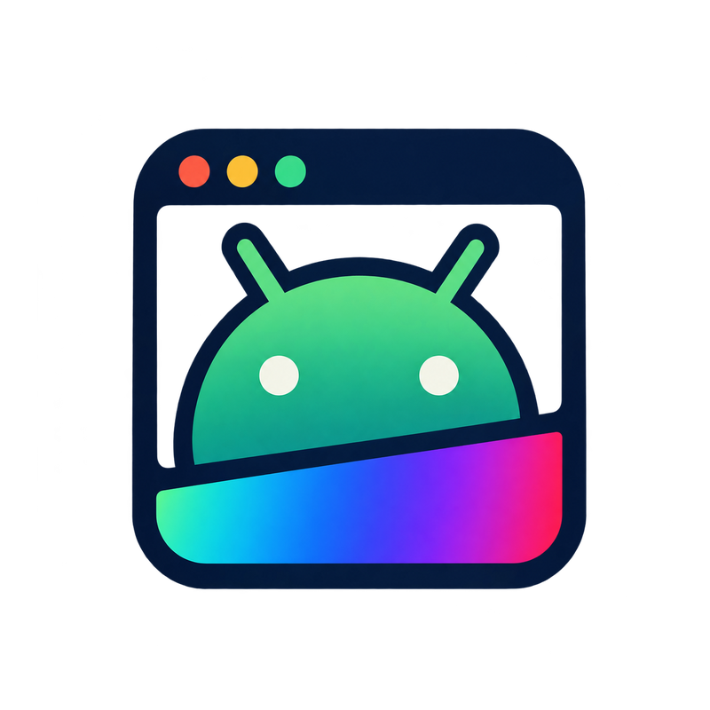

<p align="center">
  
</p>

<h1 align="center">Android Runtime for Linux</h1>

<p align="center">
  Explore Android applications as Linux desktop windows — without requiring every contributor to build Android from source.
</p>

<p align="center">
  <a href="https://github.com/gjtaskers-sys/android-runtime-linux/actions/workflows/ci.yml"></a>
  
  <a href="LICENSE"></a>
</p>

> **Early-stage project:** the host-side tools and synthetic X11 display path have been tested. The custom Android container has **not** yet been demonstrated booting end to end, and real Android-rendered frames have **not** yet been verified in the desktop window. This is not a stable runtime or a security boundary for untrusted apps.

## What works today?

- **Inspect an APK:** read package metadata and detect supported native-library ABIs.
- **Use an Android development emulator:** the CLI has installed and launched 2048 through ADB, and the game was confirmed playable.
- **Test the native X11 bridge:** the helper displays synthetic frames; automated tests read pixels back and verify the gradient's colors.
- **Run repeatable checks:** Rust tests and linting, frame validation, mocked DMA-BUF synchronization, acquire-fence checks, and X11 lifecycle tests are included.

Those tests verify the host tools and emulator workflow. They do **not** mean an Android system image already runs inside this project's LXC container.

## Demos

Short demos are being prepared. The first two demonstrations will show different parts of the prototype:

1. **APK workflow:** 2048 running in the Android SDK development emulator. This demonstrates APK inspection/install/launch through the CLI; it is not yet the custom LXC runtime.
2. **Display bridge:** the smooth RGB gradient shown in a native X11 window. These are synthetic test frames, not Android app graphics.

See the [recording guide](docs/RECORDING_DEMOS.md) for capture recommendations and how to add the clips when they are ready.

## Getting started

You do **not** need to build AOSP to compile or test the host project. Most contributions can be made with Rust, the native display dependencies, and (for emulator testing) the Android SDK.

### 1. Install host dependencies

On Ubuntu 24.04, Debian 13, or a compatible Linux Mint release:

```bash
sudo apt update
sudo apt install build-essential pkg-config libx11-dev libxext-dev xvfb xauth zstd
```

Install Rust using [rustup](https://rustup.rs/); the required stable toolchain and the `rustfmt` and `clippy` components are declared in `rust-toolchain.toml`.

### 2. Build and test

Run these from the repository directory:

```bash
cargo fmt --all
cargo fmt --all -- --check
cargo test --workspace --locked
cargo clippy --workspace --all-targets --locked -- -D warnings
cargo build --workspace --locked
```

Then test the host-side display bridge:

```bash
./scripts/test-frame-validation.sh
./scripts/test-dma-buf-sync.sh
./scripts/test-acquire-fence-wait.sh
./scripts/build-x11-display.sh
./scripts/test-x11-display.sh
```

The X11 smoke test needs an X11 desktop session. For a headless system, run it using Xvfb:

```bash
xvfb-run -a -s "-screen 0 1600x1400x24" ./scripts/test-x11-display.sh
```

The display test uses generated frames and checks the actual pixels in the X11 window. It does not test Android's graphics buffers.

### 3. Try APK management through the development emulator (optional)

This path requires the Android SDK and an Android Virtual Device; it does not require a full AOSP checkout.

```bash
./scripts/android/bootstrap-dev-android.sh
./scripts/android/run-dev-android.sh
cargo build --workspace
./target/debug/android-runtime devices
```

Inspect an APK you already trust:

```bash
./target/debug/android-runtime apk-info /path/to/your-app.apk
```

Install and launch it, using the serial shown by `devices` if it is not `emulator-5554`:

```bash
./target/debug/android-runtime install /path/to/your-app.apk --serial emulator-5554
```

**Only install APKs you trust.** The current development emulator is a testing backend, not the intended production execution path. See the [emulator guide](docs/DEV_ANDROID.md) for more detail.

## What still needs to be built?

The largest open milestones are:

1. **Boot Android in LXC:** validate a contributor-built Android root filesystem on a documented host and demonstrate Android services becoming ready.
2. **Display real Android frames:** connect SurfaceFlinger/Composer3 client-target buffers to the host window and verify format, stride, file descriptors, fences, and synchronization end to end.
3. **Make it usable as a desktop app:** input, keyboard and IME behavior, resizing, orientation, start/stop, and crash recovery.
4. **Define a supportable release:** test hardware and distribution combinations, document isolation limits, and complete installation, update, licensing, and security reviews.

The [roadmap](ROADMAP.md) contains success criteria and contribution ideas for each milestone.

## How can you help?

You can make useful contributions without a powerful AOSP build machine. Good places to start include:

- Run tests on another Linux distribution or kernel and report versions plus sanitized logs.
- Improve onboarding, errors, tests, CI, packaging, or documentation.
- Review the display protocol, DMA-BUF formats, synchronization, and lifetime assumptions.
- Help with LXC configuration or Android graphics if you have relevant experience.
- If you have suitable hardware for a full AOSP build, help produce a reproducible candidate image with source revisions, checksums, and validation results.

Start with [`CONTRIBUTING.md`](CONTRIBUTING.md), then pick a task from the [roadmap](ROADMAP.md). A full AOSP build is **not** required for ordinary host-side contributions.

## Project docs

- [Beginner-friendly getting-started guide](docs/GETTING_STARTED.md)
- [Demo recording and media guide](docs/RECORDING_DEMOS.md)
- [GitHub page assets and social preview](docs/PROJECT_PAGE.md)
- [Architecture overview](docs/ARCHITECTURE.md)
- [Build guide](docs/BUILDING.md)
- [Android image handoff](docs/CONTRIBUTOR_IMAGE_HANDOFF.md)
- [Design rationale and references](docs/DESIGN_RATIONALE.md)
- [Roadmap](ROADMAP.md)
- [Contribution guidelines](CONTRIBUTING.md)
- [Security policy](SECURITY.md)

## License

Project-authored source is licensed under Apache-2.0; see [`LICENSE`](LICENSE). Android platform components, app APKs, firmware, images, and future third-party integrations have separate licensing and redistribution considerations. No Android system image or proprietary ARM translator is included.
