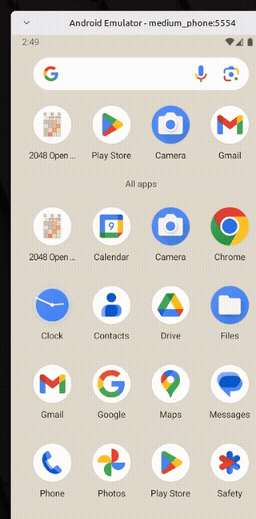
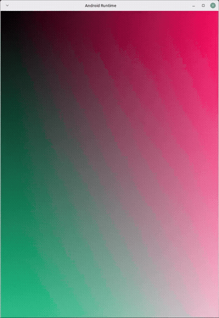

<p align="center">
  
</p>

<h1 align="center">Android Runtime for Linux</h1>

<p align="center">
  An experimental project exploring Android applications in native Linux desktop windows.
</p>

<p align="center">
  <a href="https://github.com/gjtaskers-sys/android-runtime-linux/actions/workflows/ci.yml"></a>
  
  <a href="LICENSE"></a>
</p>

> **Current limitation:** host-side tools and a synthetic X11 display test are working, but the custom Android container has not yet been demonstrated booting end to end, and real Android-rendered frames have not yet been verified in the desktop window. This is not a stable runtime or a security boundary for untrusted apps.

## See the prototype

These short recordings show two separate pieces of the project. Neither is a demonstration of Android running inside the planned LXC container.

### 2048 in the Android SDK development emulator

[](https://raw.githubusercontent.com/gjtaskers-sys/android-runtime-linux/main/assets/demo/2048-android-sdk-emulator.mp4)

The project CLI has been used to inspect, install, and launch 2048 through ADB; the game runs in the Android SDK development emulator. This is a development/test backend, not the custom LXC runtime.

[Open the cropped MP4 recording](https://raw.githubusercontent.com/gjtaskers-sys/android-runtime-linux/main/assets/demo/2048-android-sdk-emulator.mp4)

### Native X11 display bridge: synthetic gradient

[](https://raw.githubusercontent.com/gjtaskers-sys/android-runtime-linux/main/assets/demo/x11-synthetic-gradient.mp4)

The host display helper presents generated RGB frames in an X11 window. The automated test reads pixels back from the window to check their colors and orientation. These frames are synthetic—not output from an Android app.

[Open the cropped MP4 recording](https://raw.githubusercontent.com/gjtaskers-sys/android-runtime-linux/main/assets/demo/x11-synthetic-gradient.mp4)

## What works today

- **APK inspection:** reads package metadata and detects native-library ABIs.
- **Emulator-based APK workflow:** inspects, installs, and launches an APK through ADB on an Android SDK development emulator.
- **Host X11 display path:** accepts synthetic frames over a Unix socket, validates frame metadata, and checks displayed pixels.
- **Automated checks:** Rust unit tests, strict Clippy, frame validation, DMA-BUF synchronization and acquire-fence tests, X11 lifecycle tests, and rootfs tooling tests.

The tests validate the host components and development-emulator workflow. They do **not** prove that Android boots in the project's LXC configuration or that Android's real graphics buffers reach the X11 window.

## Try the host-side tests

The host-side display test is the easiest reproducible starting point. It requires a Linux X11 session, Rust, and the native X11 development packages. On Ubuntu, Debian, or a compatible Linux Mint release, install the packages:

```bash
sudo apt update
sudo apt install build-essential pkg-config libx11-dev libxext-dev xvfb xauth zstd
```

Install Rust with [rustup](https://rustup.rs/), then run from the repository directory:

```bash
cargo fmt --all -- --check
cargo test --workspace --locked
cargo clippy --workspace --all-targets --locked -- -D warnings
cargo build --workspace --locked
./scripts/test-x11-display.sh
```

The X11 test opens a window, sends eight changing synthetic frames, validates sample pixels, and checks acknowledgement sequencing and window/socket cleanup. On a headless host, run it through Xvfb:

```bash
xvfb-run -a -s "-screen 0 1600x1400x24" ./scripts/test-x11-display.sh
```

For the optional Android SDK emulator workflow, follow [Getting started](docs/GETTING_STARTED.md). A full AOSP checkout or build is not required for ordinary host-side contributions.

## What remains to be built

1. **Boot Android in LXC:** verify a candidate Android root filesystem reaches Android service readiness and can install and launch an APK.
2. **Display real Android frames:** connect SurfaceFlinger/Composer3 buffers to the host window and verify format, stride, file descriptors, fences, synchronization, and lifetime.
3. **Desktop usability:** implement and test input, keyboard/IME, resizing, orientation, start/stop, and recovery.
4. **Release readiness:** establish supported host configurations, isolation guarantees, installation/update behavior, and licensing/provenance review.

See the [roadmap](ROADMAP.md) for success criteria and concrete contribution opportunities.

## How to contribute

Contributions are welcome in testing, documentation, Rust/C development, Linux container behavior, Android graphics, and compatibility reporting. Useful starting points include:

- Run the test suite on another Linux distribution or kernel and report versions plus sanitized logs.
- Improve CLI diagnostics, test coverage, CI, packaging, or onboarding.
- Review DMA-BUF formats, fences, buffer ownership, and protocol failure cases.
- Help validate an Android root filesystem or build a candidate image if suitable hardware is available.

A full AOSP build is **not** required for most contributions. Start with [Contributing](CONTRIBUTING.md) and choose a task from the [roadmap](ROADMAP.md).

## Project documentation

- [Getting started](docs/GETTING_STARTED.md)
- [Architecture overview](docs/ARCHITECTURE.md)
- [Build guide](docs/BUILDING.md)
- [Android rootfs contributor handoff](docs/CONTRIBUTOR_IMAGE_HANDOFF.md)
- [Design rationale and references](docs/DESIGN_RATIONALE.md)
- [Roadmap](ROADMAP.md)
- [Security policy](SECURITY.md)

## License

Project-authored source is licensed under Apache-2.0; see [`LICENSE`](LICENSE). Android platform components, app APKs, firmware, system images, and third-party integrations have separate licensing and redistribution considerations. This repository does not include an Android system image or a proprietary ARM translator.
